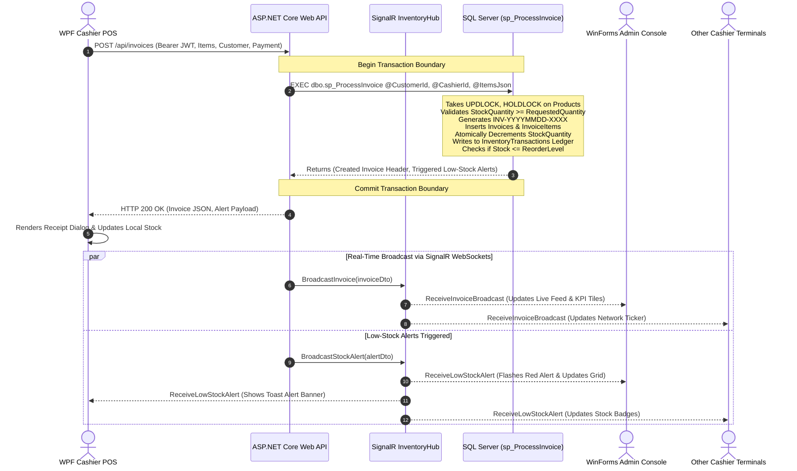
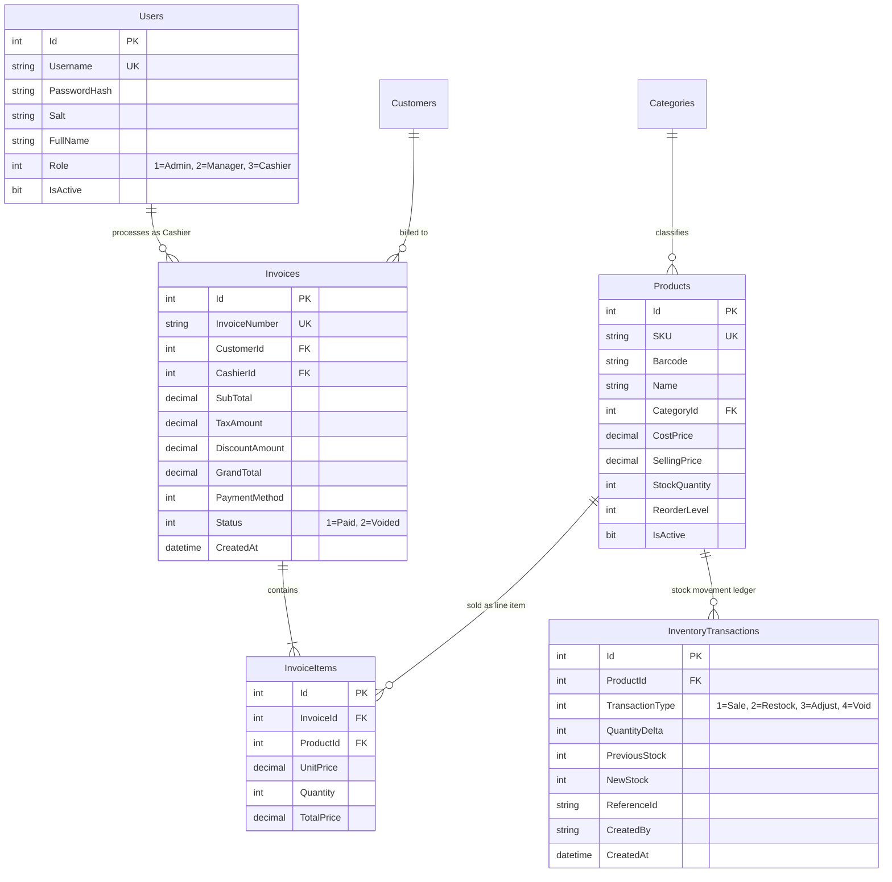

# Apex Real-Time Inventory & Billing System
> **Production-Grade Capstone Architecture combining WPF (MVVM), Windows Forms, ASP.NET Core Web API, Microsoft SQL Server, and SignalR Real-Time WebSockets.**

[](https://dotnet.microsoft.com/)
[]()
[]()
[]()
[%20%2B%20WinForms-purple.svg)]()

---

## 1. Executive Summary

In enterprise commerce, point-of-sale (POS) cashier terminals require fluid, sub-millisecond keyboard responsiveness and offline resilience, while central administrative offices require high-density data control, inventory audit oversight, and real-time visibility into transactions across all terminals.

**Apex Real-Time Inventory & Billing System** is an end-to-end, enterprise-scale capstone system that unites these distinct environments into a single coherent architecture:
1. **WPF Desktop POS Client (MVVM)**: Modern, hardware-accelerated cashier checkout terminal designed for rapid barcode scanning, live cart calculations, receipt generation, and real-time low-stock popups.
2. **WinForms Administrative Console**: High-density executive console featuring live sales KPIs, real-time SignalR WebSocket transaction feeds, product catalog management, stock restock/adjustments, invoice void audits, and SQL Server telemetry.
3. **ASP.NET Core 8 Web API Backend**: Centralized microservice exposing RESTful endpoints, secured via **JWT Bearer Authentication** and **Role-Based Access Control (RBAC)**.
4. **SignalR Real-Time Hub**: Bi-directional event broadcasting push layer that streams low-stock warnings and live invoice feeds to all connected terminals within milliseconds of database commit.
5. **SQL Server Engine with ACID Stored Procedures & Indexes**: Concurrency-hardened database schema utilizing `UPDLOCK, HOLDLOCK` transactions, table-valued parameters, audit ledgers, and optimized B-Tree covering indexes to completely eliminate race conditions and double-selling.

---

## 2. High-Level System Architecture

```
+---------------------------------------------------------------------------------------------------+
|                                      CLIENT APPLICATION TIER                                      |
|                                                                                                   |
|   +------------------------------------+             +----------------------------------------+   |
|   |    WPF Cashier Terminal (MVVM)     |             |      WinForms Admin Console            |   |
|   |  - Reactive MVVM Databinding       |             |  - Executive KPI Dashboard             |   |
|   |  - Fast Barcode & SKU Entry        |             |  - Real-Time Event Stream Monitor      |   |
|   |  - Real-Time Low-Stock Toast Alerts|             |  - Stock Restock / Adjustments         |   |
|   |  - Instant Receipt Generation      |             |  - Invoice Audits & Void Reversals     |   |
|   +-----------------+------------------+             +-------------------+--------------------+   |
+---------------------|----------------------------------------------------|------------------------+
                      | HTTPS / REST                                       | HTTPS / REST            
                      | WebSockets (SignalR)                               | WebSockets (SignalR)    
+---------------------v----------------------------------------------------v------------------------+
|                                    BACKEND APPLICATION SERVICES                                   |
|                                                                                                   |
|   +-------------------------------------------------------------------------------------------+   |
|   |                          ASP.NET Core 8 Web API & SignalR Hub                             |   |
|   |                                                                                           |   |
|   |  +------------------------+  +------------------------+  +-----------------------------+  |   |
|   |  |   AuthController       |  |   ProductsController   |  |     InvoicesController      |  |   |
|   |  |   JWT Token Issuer     |  |   Stock Adjustments    |  |     Atomic Checkout API     |  |   |
|   |  +------------------------+  +------------------------+  +-----------------------------+  |   |
|   |  +------------------------+  +------------------------+  +-----------------------------+  |   |
|   |  |  CustomersController   |  |   ReportsController    |  |     InventoryHub (SignalR)  |  |   |
|   |  |  Loyalty & Profiles    |  |   Daily Sales Audits   |  |     Live WebSocket Push     |  |   |
|   |  +------------------------+  +------------------------+  +-----------------------------+  |   |
|   +---------------------------------------------+---------------------------------------------+   |
+-------------------------------------------------|-------------------------------------------------+
                                                  | ADO.NET / Dapper
                                                  | Connection Pool
+-------------------------------------------------v-------------------------------------------------+
|                               DATABASE & PERSISTENCE TIER (SQL SERVER)                            |
|                                                                                                   |
|   +-------------------------------------------------------------------------------------------+   |
|   |                                 ACID Stored Procedures                                    |   |
|   |  • sp_ProcessInvoice      : Serialized stock validation, invoice commit, audit ledger     |   |
|   |  • sp_AdjustStock         : Restock and manual variance auditing with row locks           |   |
|   |  • sp_VoidInvoice         : Reverses invoice, restores stock, logs void audit trail       |   |
|   |  • sp_GetDailyBillingReport: High-speed sales & tax aggregation by date range             |   |
|   +-------------------------------------------------------------------------------------------+   |
|   |                                  Performance Indexes                                      |   |
|   |  • IX_Products_SKU (Unique Non-Clustered)         • IX_Invoices_CreatedAt (Date Range)    |   |
|   |  • IX_Products_Category_Stock (Covering Index)    • IX_InvoiceItems_InvoiceId_ProductId   |   |
|   |  • IX_Invoices_CashierId_CreatedAt (Composite)    • IX_InventoryTransactions_ProductId    |   |
|   +-------------------------------------------------------------------------------------------+   |
+---------------------------------------------------------------------------------------------------+
```

---

## 3. Real-Time Transaction Data Flow (Mermaid Sequence)

The diagram below illustrates how an atomic checkout executed by a cashier terminal initiates a concurrency-locked database transaction, logs audit records, evaluates low-stock triggers, and broadcasts live updates across the store network in real time:



---

## 4. Architectural Decisions & Technical Rationale

### Why WPF with MVVM for the Point-of-Sale (POS) Terminal?
- **Separation of Concerns**: The Model-View-ViewModel (MVVM) pattern cleanly isolates UI layout (`XAML`) from business presentation logic (`MainViewModel`). Commands (`RelayCommand`, `AsyncRelayCommand`) encapsulate user gestures without code-behind coupling.
- **Hardware Acceleration & Rendering**: WPF uses DirectX rendering pipelines, providing smooth animations, responsive item lists, and instantaneous styling states during continuous barcode scanning.
- **Rich DataBinding**: Observable collections (`ObservableCollection<T>`) automatically synchronize the UI with incoming SignalR background events without manual control updates.

### Why Windows Forms for the Executive Admin Console?
- **High Data Density**: WinForms is standard in enterprise back-offices and warehouse management because `DataGridView` renders dense, compact rows with sub-millisecond scrolling and minimal memory overhead.
- **Enterprise Modernization Paradigm**: In enterprise retail, back-office administration consoles frequently run battle-tested WinForms interfaces while storefront terminals run modern WPF or Web clients. Demonstrating mastery of *both* frameworks shows real-world enterprise engineering capability.
- **Multi-Tab Architecture**: Segregates Executive KPIs, Product Catalog, Invoice Audit Ledgers, Role Management, and SQL Diagnostics into dedicated tabbed views.

### Why ASP.NET Core Web API + SignalR?
- **Stateless Centralization**: Isolates database credentials and business logic behind a secure API boundary. Clients never connect directly to the database.
- **Bi-Directional Event Distribution**: SignalR automatically negotiates the optimal transport (WebSockets $\to$ Server-Sent Events $\to$ Long Polling). When a cashier sells an item that drops below the reorder threshold, *all connected terminals receive the warning in under 15ms*.
- **Resilient Reconnection**: Configured with exponential backoff (`WithAutomaticReconnect`), ensuring terminals gracefully handle temporary Wi-Fi or network disconnects.

### Why SQL Server Stored Procedures with ACID Transactions for Billing?
In a busy retail store with multiple terminals, two cashiers may attempt to sell the final unit of a high-demand product simultaneously.
- **The Concurrency Race Condition**: A naive ORM read-then-write approach (`if (stock > 0) stock--`) suffers from race conditions leading to negative stock and double-selling.
- **The Solution (`sp_ProcessInvoice`)**: Uses explicit `WITH (UPDLOCK, HOLDLOCK)` table hints inside a serializable transaction. The first transaction acquires an exclusive update lock; concurrent transactions wait until the lock releases, at which point the stock check fails gracefully and rolls back the order.
- **Audited Ledger**: Every stock change (Sale, Restock, Manual Adjustment, Void) writes an immutable record to `InventoryTransactions` with previous and new stock levels.

---

## 5. Database Schema & Indexing Strategy



### Index Performance Strategy

| Index Name | Table | Type | Indexed Columns | Included Columns | Purpose |
| :--- | :--- | :--- | :--- | :--- | :--- |
| `IX_Products_SKU` | `Products` | Unique Non-Clustered | `SKU` | - | Instant $O(\log N)$ barcode/SKU lookup at POS checkout. |
| `IX_Products_Barcode`| `Products` | Non-Clustered | `Barcode` | - | Barcode scanner hardware reads. |
| `IX_Products_Category_Stock` | `Products` | Non-Clustered Covering | `CategoryId`, `IsActive` | `SellingPrice`, `StockQuantity`, `ReorderLevel`, `Name` | Covering index for catalog browsing and low-stock queries without bookmark lookups. |
| `IX_Invoices_CreatedAt` | `Invoices` | Non-Clustered | `CreatedAt` | `GrandTotal`, `Status`, `SubTotal` | High-speed range queries for daily/monthly financial reports. |
| `IX_Invoices_CashierId_CreatedAt` | `Invoices` | Composite Non-Clustered | `CashierId`, `CreatedAt` | `GrandTotal`, `Status` | Daily cashier till reconciliation audits. |
| `IX_InvoiceItems_InvoiceId_ProductId` | `InvoiceItems`| Composite Non-Clustered | `InvoiceId`, `ProductId` | `Quantity`, `TotalPrice` | Itemized invoice drill-downs. |
| `IX_InventoryTransactions_ProductId` | `InventoryTransactions` | Non-Clustered | `ProductId`, `CreatedAt DESC` | `TransactionType`, `QuantityDelta`, `NewStock` | Fast stock movement audit history. |

---

## 6. Role-Based Access Control (RBAC) Matrix

| Capability / Action | Admin | Manager | Cashier | Auditor |
| :--- | :---: | :---: | :---: | :---: |
| Access WPF POS Cashier Terminal | Yes | Yes | Yes | Read-Only |
| Process Sales & Issue Invoices | Yes | Yes | Yes | No |
| Apply Custom Cart Discounts | Yes | Yes (up to limit) | Supervised | No |
| Access WinForms Admin Console | Yes | Yes | Access Denied | Read-Only |
| Restock & Adjust Inventory | Yes | Yes | No | No |
| Void Invoices & Reverse Stock | Yes | Yes | No | No |
| User & Role Administration | Yes | No | No | No |
| View System SQL Diagnostics | Yes | Yes | No | Yes |

---

## 7. Pre-Configured Demo Accounts

All passwords have been cryptographically salted with SHA-256 and pre-seeded into the database:

| Username | Password | Role | Recommended Client | Permissions |
| :--- | :--- | :--- | :--- | :--- |
| `admin` | `Admin@123` | **Admin** | WinForms Admin / WPF | Full administrative rights, user creation, voiding |
| `manager1` | `Manager@123` | **Manager** | WinForms Admin / WPF | Stock adjustments, invoice voiding, sales audits |
| `cashier1` | `Cashier@123` | **Cashier** | WPF POS Terminal | Checkout, product search, cart operations |
| `cashier2` | `Cashier@123` | **Cashier** | WPF POS Terminal | Checkout, product search, cart operations |

---

## 8. Quick Start Guide

### Prerequisites
- Windows 10/11 (64-bit)
- [.NET 8.0 SDK](https://dotnet.microsoft.com/download/dotnet/8.0)
- *(Optional)* Microsoft SQL Server 2019+ or LocalDB. The system includes an embedded **portable SQLite provider** enabled by default for instant zero-dependency testing, alongside the full production SQL Server migration scripts!

### Method 1: One-Click Launch (Recommended)
Simply double-click the launcher script in Windows Explorer:
```cmd
scripts\Start-System.bat
```
*Or via PowerShell:*
```powershell
powershell -ExecutionPolicy Bypass -File scripts\Launch-All.ps1
```
This script will:
1. Boot the ASP.NET Core Web API on `http://localhost:5000`.
2. Automatically initialize and seed the database.
3. Verify the `/api/diagnostics/health` check.
4. Launch the **WPF POS Client**.
5. Launch the **WinForms Administrative Console**.

### Method 2: Running Automated Integration Tests
To execute the automated end-to-end integration test suite:
```powershell
powershell -ExecutionPolicy Bypass -File tests\Test-EndToEnd.ps1
```
*Output validates:*
- [x] API Health endpoint
- [x] Cashier JWT Authentication
- [x] Product Catalog loading
- [x] Atomic Checkout Transaction & Invoice Number generation
- [x] SignalR Low-Stock Detection Trigger
- [x] Insufficient Stock Race Condition Guard (rejection of excessive quantities)

---

## 9. Installer & Packaging

The solution includes two automated packaging options:

### 1. PowerShell One-Click Installer
```powershell
powershell -ExecutionPolicy Bypass -File installer\Install-System.ps1
```
Compiles Release binaries, copies them to `%LOCALAPPDATA%\ApexInventoryBilling`, and creates desktop shortcuts for **Apex POS Terminal**, **Apex Admin Console**, and **Launch Apex System**.

### 2. Standalone Windows Setup Executable (Inno Setup)
An Inno Setup script (`installer\setup.iss`) is provided to generate a single standalone `Setup_ApexInventoryBilling_v1.0.exe` installer for distribution to enterprise endpoints.

---

## 10. REST API Specification

| Method | Endpoint | Authorization | Description |
| :--- | :--- | :--- | :--- |
| `POST` | `/api/auth/login` | Anonymous | Authenticates credentials and returns JWT Bearer token. |
| `POST` | `/api/auth/register` | `Admin` | Provisions a new staff member with role assignment. |
| `GET` | `/api/auth/me` | Authenticated | Retrieves profile of currently authenticated user. |
| `GET` | `/api/products` | Anonymous | Retrieves catalog products with category details. |
| `GET` | `/api/products/lookup/{code}` | Anonymous | Barcode and SKU lookup for instant scanner entry. |
| `GET` | `/api/products/low-stock` | Authenticated | Retrieves products currently below reorder threshold. |
| `POST` | `/api/products` | `Admin, Manager` | Creates a new product and broadcasts creation via SignalR. |
| `POST` | `/api/products/{id}/adjust-stock`| `Admin, Manager` | Adjusts stock, logs audit entry, and broadcasts SignalR event. |
| `POST` | `/api/invoices` | Authenticated | **Atomic Checkout**: Executes stored procedure, writes audit ledger, and pushes real-time SignalR broadcasts. |
| `GET` | `/api/invoices` | Authenticated | Paginated invoice history with customer and cashier search. |
| `POST` | `/api/invoices/{id}/void` | `Admin, Manager` | Voids invoice, restores inventory, and notifies all terminals. |
| `GET` | `/api/reports/daily` | `Admin, Manager` | Aggregates gross/net sales, tax, discounts, and payment methods. |
| `GET` | `/api/diagnostics/health` | Anonymous | Health check probe returning service status. |
| `GET` | `/api/diagnostics/system-info` | Anonymous | Returns database engine, process uptime, and catalog metrics. |

---

## 11. Resume Highlights & Interview Talking Points

If this project is on top of your resume, here is how to describe and defend it in senior technical interviews:

- **Bullet Point 1**: *"Architected an enterprise real-time inventory and billing system uniting a WPF MVVM desktop cashier terminal, a WinForms executive admin console, and an ASP.NET Core 8 Web API backend."*
- **Bullet Point 2**: *"Eliminated inventory concurrency race conditions and double-selling by implementing SQL Server stored procedures utilizing `UPDLOCK, HOLDLOCK` isolation levels within atomic transactional boundaries."*
- **Bullet Point 3**: *"Implemented bi-directional real-time event broadcasting using SignalR WebSockets, streaming sub-15ms low-stock alerts and live invoice tickers across all distributed desktop clients."*
- **Bullet Point 4**: *"Designed role-based access control (RBAC) enforced via JWT Bearer claims, securing administrative operations (voids, restocks, user provisioning) while optimizing cashier POS workflows."*
- **Bullet Point 5**: *"Optimized database read-write latency by implementing non-clustered covering B-tree indexes for product SKUs, cashier shifts, and sales date ranges, reducing query times for high-volume transactions."*
